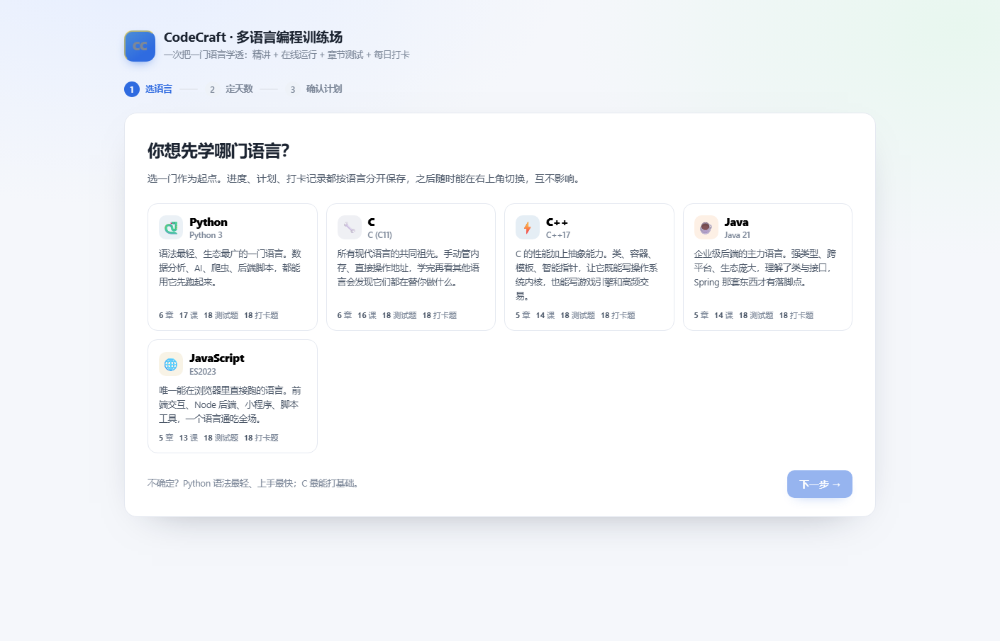
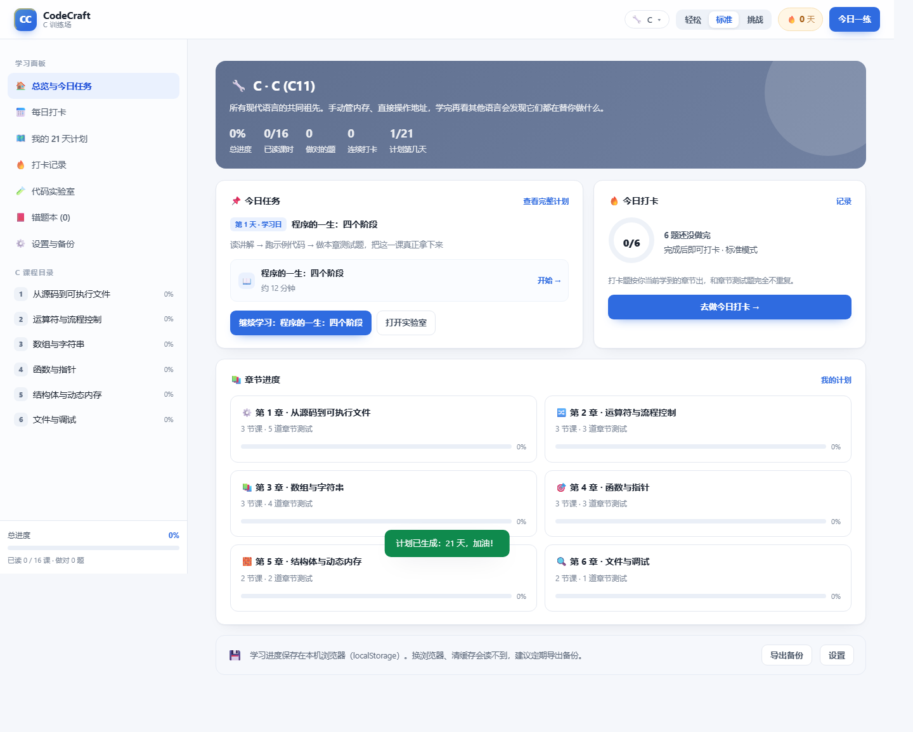
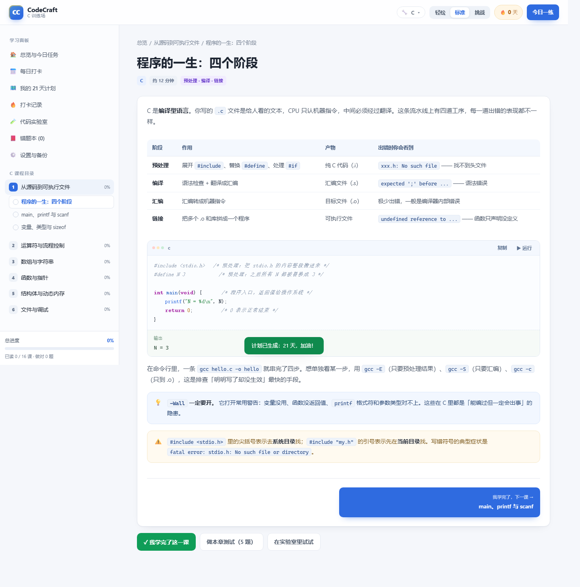
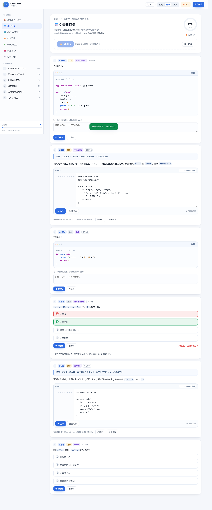
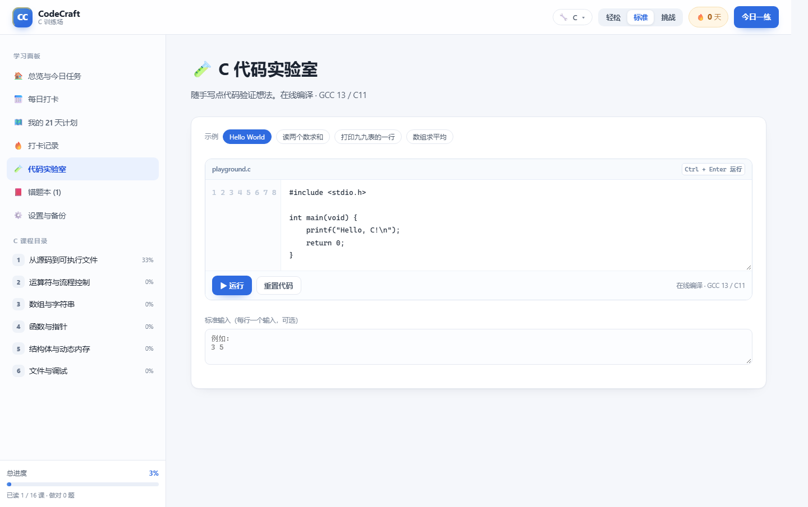

# CodeCraft · 多语言编程训练场

一个**单文件**的编程学习站：选一门语言、定一个学习周期，自动生成学习计划，每天看课 + 做章节测试 + 每日打卡，进度存在本地，关掉再开还在。

Python / C / C++ / Java / JavaScript 五门语言，74 个课时，180 道题，代码可以在页面里直接跑。

**在线直接打开：https://pan179.github.io/codecraft/**

> 双击 `CodeCraft.html` 就能用，不需要装环境、不需要联网注册。全部内容都在一个文件里。

---

## 一分钟用起来

### 方式 A：装到桌面，像本地应用一样（Windows，推荐）

1. 点右上角绿色 **Code** → **Download ZIP**
2. 解压，双击 **`安装到桌面.cmd`**
3. 桌面出现 `CodeCraft 学习站` 图标，双击打开的是**没有地址栏的独立窗口**

安装脚本做的事很简单：把 `CodeCraft.html` 和图标复制到 `%LOCALAPPDATA%\Programs\CodeCraft`，再在桌面建一个快捷方式（用 Chrome / Edge 的 `--app` 模式打开）。不想用了就删掉快捷方式和那个文件夹。

### 方式 B：直接用

下载 `CodeCraft.html`，双击。任何现代浏览器都行，Windows / macOS / Linux 通吃。

### 方式 C：网页版，什么都不装

**https://pan179.github.io/codecraft/**

手机、平板、别人的电脑，打开就能练。注意进度是存在浏览器里的，和本地版的进度**不互通**。

---

## 它是怎么工作的

第一次打开会走三步引导：

1. **选语言** —— 五张语言卡，各自标着章数、课时数、题目数
2. **定周期** —— 7 / 14 / 21 / 30 / 42 天，或者自己填一个数；可选项会跟着课时量自动收敛，不会出现"16 节课排 60 天、44 天都在复习"这种事
3. **看计划** —— 学习日 / 复习日 / 冲刺日怎么分布，先看一遍再确认

确认后进入学习界面，左侧是导航和课程目录，右侧是内容区。

### 六个页面

| 页面 | 作用 |
|---|---|
| 总览与今日任务 | 总进度、连续天数、今天的课、章节进度条 |
| 每日打卡 | 按当前学习进度出题，全部答对才能打卡 |
| 我的 N 天计划 | 每天干什么，已完成打勾 |
| 打卡记录 | 日历热力图，一眼看出哪天断了 |
| 代码实验室 | 选语言写代码，直接运行看输出 |
| 错题本 | 答错的题自动收进来，按错误次数排序 |

### 两套题，不重叠

- **章节测试**：每章学完做，考这一章的概念和陷阱
- **每日打卡**：按你**已经学过的章节**抽题，跨章节混合，考记忆留存

两套题库完全独立（各 18 题 / 语言），题目 id 和题干都做了防重。仓库里有一条自动断言在跑这件事，改题库时如果撞题会直接报错。

### 代码真的能跑

- **JavaScript**：浏览器 iframe 沙箱里跑，离线可用
- **Python / C / C++ / Java**：走 Wandbox 在线编译，需要联网

实验室页面有标准输入框，支持 `readline` / `input()` / `scanf` / `Scanner` 那套。课时页的代码块上也有"运行"按钮，改两行立刻看结果。

> 在线编译用的是公共接口，偶尔会限流。前端会自动重试两次，还失败就给一句人话提示，不影响打卡和学习进度。

---

## 进度存在哪

`localStorage`，key 是 `codecraft.v2`，按语言分桶存。换浏览器、清缓存、换设备都会丢——设置页有"导出备份"，导出一段 JSON，换地方粘回去就恢复了。

**注意**：`file://` 打开的页面和在 GitHub Pages 上打开的页面是两个不同的源，进度不互通。认准一种用法就行。

---

## 内容规模

| 语言 | 章 | 课时 | 章节测试 | 每日打卡 |
|---|---|---|---|---|
| Python | 6 | 17 | 18 | 18 |
| C | 6 | 16 | 18 | 18 |
| C++ | 5 | 14 | 18 | 18 |
| Java | 5 | 14 | 18 | 18 |
| JavaScript | 5 | 13 | 18 | 18 |

课时里包含：概念讲解、可运行示例、常见坑（`warn`）、要点小结。示例代码的输出都是**真跑过**核对过的——仓库里有脚本对每个示例实际执行并比对期望输出。

---

## 截图







---

## 开发

```bash
node build.js          # 把 src 打包成单文件，输出 dist/ 和根目录 CodeCraft.html
node test/verify.js    # 数据与核心逻辑自检（计划 45 例 / 出题 600 例）
node test/e2e.js       # 真浏览器跑一遍主流程（需本机有 Edge）
node test/e2e-daily.js # 每日打卡闭环
```

源码结构：

```
src/
  index.html      骨架 + 占位符
  style.css       全部样式
  js/core.js      纯函数核心（计划生成、出题、统计），可在 Node 里直接测
  js/ui.js        渲染工具（语法高亮、块级排版、弹窗）
  js/runner.js    代码运行（Wandbox + iframe 沙箱）
  js/app-*.js     各个页面
  data/lang-*.js  五门语言的课程与题库
tools/
  make-icon.js    生成多尺寸 icon.ico
  make-shortcut.js/.lnk 生成 Windows 快捷方式
```

### 加一门语言

1. 复制 `src/data/lang-python.js` 改成新语言，按同样的结构写 `chapters` / `quiz` / `checkin`
2. 在 `build.js` 的 `DATA_FILES` 里加一行
3. 在 `src/js/app-base.js` 的 `App.ORDER` 里加一行

界面上的语言卡会自动多出来。

---

## 已知限制

- Python / C / C++ / Java 的运行依赖 Wandbox 公共编译服务，离线时只有 JavaScript 能跑
- 进度只在本机浏览器里，没有账号系统，不跨设备同步
- 在线判题只做"输出比对"，不做代码风格检查

---

## License

MIT，随便用、随便改。
